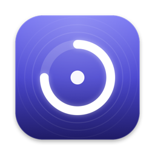

<p align="center">
  
</p>

<h1 align="center">Immerse</h1>

<p align="center"><a href="README.md">简体中文</a> | <b>English</b></p>

> Plan your day with the lightest touch. Focus with the strongest pull.

A macOS calendar app for scheduling and deep focus: manage your events on a calendar, hit **Start** to begin a focus timer and turn on Do Not Disturb, and get notified when time is up.

> **Note:** The app's interface is currently in Simplified Chinese, and it shows up as **沉浸日程** in the Dock and Finder.

## Features

| Module | Features |
|---|---|
| 📅 Calendar | Day / week / month views with an animated zoom transition between them; drag-select or double-click to create, drag to move, drag an edge to resize; overlapping events are laid out side by side; month cells show up to 3 events and collapse the rest into "+N" |
| 🗂 Sidebar | Mini month calendar for quick navigation; below it, a Today / Inbox / Goals switch shows one panel at a time: Today lists tasks by priority and time (click the circle to complete), Inbox captures ideas you can drag onto the calendar, and Goals show a progress ring with days left. A focus summary at the bottom opens the stats window |
| ✏️ Events | Priority (urgent / important / normal), status, location and focus duration; double-click an event to edit it in a Notion-style modal; unsaved new-event drafts are kept; ⌘Z to undo |
| 📝 Notes | WYSIWYG Markdown (Typora / Notion style): syntax renders once the caret leaves and shows again when it returns; headings, bold / italic / strikethrough, code blocks, lists, quotes, rules and `- [ ]` to-dos (click to check); pasting a URL inserts a link titled from the page, click to open. Typing `# ` `- ` `1. ` `[] ` `> ` at a line start converts instantly, and `/` (`、` with the Chinese input method) opens a searchable block menu (↑↓ to pick, Return to insert); ⌘B / ⌘I / ⇧⌘X / ⌘E / ⌘K (link the selection), ⌥⌘0–6 for text / headings / to-do / lists, ⌥⌘Q quote, ⌥⌘C code block, Tab / ⇧Tab to nest list items; right-click → 格式 (Format) lists every shortcut |
| 🔍 Search | ⌘F searches titles and notes; click a result to jump to its date and select it |
| ⌘K Command palette | Create events in natural language (Chinese), e.g. 「明天下午3点 阅读《第一性原理》 1小时 重要」 ("tomorrow 3 pm, read *First Principles*, 1 hour, important"); also runs commands and jumps to events |
| ⏱ Focus | One-click countdown; timed events start focusing automatically when they begin and switch to In Progress (a system notification one minute ahead lets you snooze 5 minutes or skip); remaining time in the menu bar; pause / +15 min / finish early / give up; full-screen immersive mode; optionally start a matching timer in the system Clock app (requires Shortcuts) |
| 🔔 Reminders | Focus progress reminders (50% / 80% by default, configurable); time-up alert; a daily 21:00 reminder for unfinished tasks (time configurable) |
| 🌙 Do Not Disturb | Turns system Do Not Disturb on via Shortcuts while you focus, and off again before the time-up alert |
| 📊 Stats | A focus summary in the sidebar opens the stats window: today / this week focus time, sessions completed this week, focus streak, a 7-day bar chart and your most-focused tasks this week |
| 🚀 First-launch guide | A 4-step guide on first launch: Welcome → Notification permission → Do Not Disturb shortcuts → Clock timer shortcut; every step can be skipped, and you can reopen it from **帮助 → 重新查看引导** (Help → Show Guide Again) |
| 📥 Import | Import a CSV exported from a Notion database, with de-duplication and a preview before importing |
| 🔄 Updates | Checks GitHub for new versions on launch (once a day, can be turned off in Settings), or manually via **沉浸日程 → 检查更新…** (Check for Updates…); the update dialog shows the release notes and lets you download, skip the version or be reminded later; your events are kept after upgrading |

## Keyboard Shortcuts

| Shortcut | Action |
|---|---|
| `⌘N` | New event (opens the new-event modal; `↩` / `⌘↩` to create) |
| Double-click an event / `↩` | Edit the event in a modal |
| `⌘K` | Command palette |
| `⌘F` | Search |
| `Space` | Start / pause focus on the selected event |
| `⌘↩` | Start focusing on the selected event |
| `⇧⌘P` | Pause / resume focus |
| `⇧⌘=` | Extend focus by 15 minutes |
| `T` | Go to today |
| `D` / `W` / `M` | Day / week / month view |
| `J` / `K` or `←` / `→` | Previous / next page |
| `⌫` / `⌘⌫` | Delete the selected event |
| `Esc` | Cancel creating / deselect |
| `⌘Z` / `⇧⌘Z` | Undo / redo |
| `⌃⌘F` | Enter immersive mode |
| `⇧⌘I` | Import Notion CSV |
| `⌘,` | Open Settings |

## Download & Install

1. Download `Immerse-x.y.z.dmg` from [Releases](https://github.com/debugzhao/Immerse/releases/latest) (macOS 14+, universal build for Apple silicon and Intel)
2. Open the DMG and drag **沉浸日程** (`Immerse.app`) into `Applications`
3. First launch: Immerse is not notarized by Apple, so macOS blocks it the first time. Allow it once, and it will open normally from then on:
   - **macOS 15 and later**: double-click the app once → open **System Settings → Privacy & Security**, scroll to the bottom and click **Open Anyway** → click **Open**
   - **macOS 14**: in `Applications`, **right-click 沉浸日程 → Open → Open**

If macOS says the app "is damaged and can't be opened", run this once in Terminal:

```bash
xattr -dr com.apple.quarantine /Applications/Immerse.app
```

## Build & Run

Requirements: macOS 14+, Xcode 16.2, XcodeGen.

```bash
scripts/build.sh
```

```bash
open build/DerivedData/Build/Products/Debug/Immerse.app
```

Package a DMG (universal Release build, written to `dist/`):

```bash
scripts/package-dmg.sh
```

Run the unit tests:

```bash
xcodegen generate && xcodebuild -project Immerse.xcodeproj -scheme Immerse -destination 'platform=macOS' test
```

> `Immerse.xcodeproj` is generated by XcodeGen from `project.yml` and is not checked into git. Run `xcodegen generate` once before opening it in Xcode.

## First Run: Set Up Do Not Disturb

On first launch, a 4-step guide walks you through setup (Welcome → Notification permission → Do Not Disturb shortcuts → Clock timer shortcut). Every step can be skipped, and you can reopen it later from **帮助 → 重新查看引导** (Help → Show Guide Again).

macOS doesn't let apps toggle Do Not Disturb directly, so Immerse uses two shortcuts in the **Shortcuts** app:

1. Create a shortcut with the action **Set Focus** → turn **Do Not Disturb** on → until turned off, and name it exactly `Immerse 开启勿扰`
2. Create another one that turns **Do Not Disturb** off, and name it exactly `Immerse 关闭勿扰`

The shortcut names must match exactly, including the Chinese characters, because Immerse runs them by name.

### Optional: Clock App Timer

Create a shortcut with **Get Numbers from Input** → **Clock → Start Timer** (set the duration to the number, in minutes), and name it `Immerse 开始计时`. Each time you start a focus session, Immerse passes the focus length in minutes to it.

## Import from Notion

In your Notion database, click `⋯` in the top-right corner → **Export** → **Markdown & CSV**. Unzip it, then in Immerse choose **文件 → 导入 Notion CSV…** (File → Import Notion CSV…, `⇧⌘I`) and confirm the preview to import.

## Docs

- [Technical design](docs/TECH_DESIGN.md) (Chinese)
