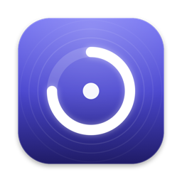

<p align="center">
  
</p>

<h1 align="center">沉浸日程 Immerse</h1>

<p align="center"><b>简体中文</b> | <a href="README.en.md">English</a></p>

> 用最轻的方式安排日程，用最强的方式进入专注。

一款 macOS 日程管理 App：以日历的形式管理日程，点击「开始」就自动计时、开启勿扰，时间到了再提醒你。

## 功能

| 模块 | 功能 |
|---|---|
| 📅 日历 | 日 / 周 / 月视图，切换时带缩放过渡动画；拖拽框选或双击新建，拖动移动、拉边缘调整时长；重叠日程自动并排；月视图每格最多显示 3 个，其余折叠为「+N」 |
| 🗂 侧边栏 | 迷你月历快速跳转；下方用「今天 / 收集箱 / 目标」分段切换，一次只看一块：今天的任务按优先级和时间排序，点圆圈即可完成；收集箱随手记想法，拖进日历即可排期；目标显示进度环和剩余天数。最下方是专注概览，点击打开统计窗口 |
| ✏️ 日程 | 优先级（紧急 / 重要 / 普通）、状态、地点、专注时长；双击日程打开 Notion 风格的弹窗编辑；新建内容未保存时会保留草稿；⌘Z 撤销 |
| 📝 备注 | 所见即所得的 Markdown（类似 Typora / Notion）：光标离开即渲染，进入才显示源码；标题、粗体 / 斜体 / 删除线、代码块、列表、引用、分隔线、`- [ ]` 待办（点击勾选）；粘贴网址自动变成带页面标题的链接，点击打开。行首输入 `# ` `- ` `1. ` `[] ` `> ` 即时转换，输入 `/`（中文输入法下 `、`）唤起块菜单，可搜索、↑↓ 选择、回车插入；⌘B / ⌘I / ⇧⌘X / ⌘E / ⌘K（选中文字时加链接），⌥⌘0–6 切换正文 / 标题 / 待办 / 列表，⌥⌘Q 引用，⌥⌘C 代码块，Tab / ⇧Tab 缩进列表；右键「格式」菜单可查看全部快捷键 |
| 🔍 搜索 | ⌘F 按标题或备注搜索，点击结果跳到对应日期并选中 |
| 💡 收集箱 | 随手记下还没定时间的想法（侧栏输入框或 ⌘K「想法：…」），有空时拖进日历排期 |
| 🎯 目标 | 本周 / 本月目标（⌘K「本月目标：…」），拖进日历安排每一次；专注时长计入进度，落后时每晚复盘提醒 |
| ⌘K 命令面板 | 中文自然语言新建：「明天下午3点 阅读《第一性原理》 1小时 重要」；也可以执行命令、跳转到日程 |
| ⏱ 专注 | 一键开始倒计时；有具体时间的日程到点自动开始专注并转为进行中（开始前 1 分钟系统通知，可推迟 5 分钟或跳过）；菜单栏显示剩余时间；暂停 / +15 分钟 / 提前完成 / 放弃；全屏沉浸模式；可同时在系统「时钟」里开倒计时（需快捷指令） |
| 🔔 提醒 | 专注进度提醒（默认 50% / 80%，可在设置里改）；时间到提醒；每天 21:00 提醒当天没完成的任务（时间可改） |
| 🌙 勿扰 | 专注时通过「快捷指令」自动开启系统勿扰，时间到先关勿扰再提醒 |
| 📊 统计 | 侧边栏显示专注概览，点击打开统计窗口：今日 / 本周专注时长、本周完成次数、连续专注天数、最近 7 天柱状图、本周专注最多的任务；日历上用绿色细条标出实际专注时间 |
| 🚀 首次引导 | 首次启动的 4 步引导：欢迎 → 通知权限 → 勿扰快捷指令 → 时钟倒计时快捷指令；每步都可跳过，可从「帮助 → 重新查看引导」再次打开 |
| 📥 导入 | 导入 Notion 数据库导出的 CSV，自动去重并先预览再导入 |
| 🔄 更新 | 启动时自动检查 GitHub 新版本（每天一次，可在设置里关闭），也可在菜单「沉浸日程 → 检查更新…」手动检查；弹窗显示更新说明，可下载、跳过此版本或稍后提醒，升级后日程数据保留 |

## 快捷键

| 快捷键 | 功能 |
|---|---|
| `⌘N` | 新建日程（打开新建弹窗，`↩` / `⌘↩` 创建） |
| 双击日程 / `↩` | 打开日程弹窗编辑 |
| `⌘K` | 命令面板 |
| `⌘F` | 搜索 |
| `Space` | 开始 / 暂停专注（选中的日程） |
| `⌘↩` | 开始专注选中的日程 |
| `⇧⌘P` | 暂停 / 继续专注 |
| `⇧⌘=` | 专注延长 15 分钟 |
| `T` | 回到今天 |
| `D` / `W` / `M` | 日 / 周 / 月视图 |
| `J` / `K` 或 `←` / `→` | 上一页 / 下一页 |
| `⌫` / `⌘⌫` | 删除选中的日程 |
| `Esc` | 取消新建 / 取消选中 |
| `⌘Z` / `⇧⌘Z` | 撤销 / 重做 |
| `⌃⌘F` | 进入沉浸模式 |
| `⇧⌘I` | 导入 Notion CSV |
| `⌘,` | 打开设置 |

## 下载安装

1. 到 [Releases](https://github.com/debugzhao/Immerse/releases/latest) 下载 `Immerse-x.y.z.dmg`（需要 macOS 14+，Apple 芯片和 Intel 都支持）
2. 打开 DMG，把「沉浸日程」（`Immerse.app`）拖进「应用程序」
3. 首次打开：App 没有经过 Apple 公证，直接双击会被系统拦下。按系统版本放行一次，之后就能正常双击启动：
   - **macOS 15 及以上**：先双击一次被拦下 → 打开「系统设置 → 隐私与安全性」，滚到底部点「仍要打开」→ 再点「打开」
   - **macOS 14**：在「应用程序」里**右键「沉浸日程」→ 打开 → 打开**

如果提示「已损坏，无法打开」，在终端执行一次：

```bash
xattr -dr com.apple.quarantine /Applications/Immerse.app
```

## 编译运行

环境要求：macOS 14+、Xcode 16.2、XcodeGen。

```bash
scripts/build.sh
```

```bash
open build/DerivedData/Build/Products/Debug/Immerse.app
```

打包 DMG（Release 通用包，输出到 `dist/`）：

```bash
scripts/package-dmg.sh
```

跑单元测试：

```bash
xcodegen generate && xcodebuild -project Immerse.xcodeproj -scheme Immerse -destination 'platform=macOS' test
```

> 工程文件 `Immerse.xcodeproj` 由 XcodeGen 根据 `project.yml` 生成，不提交到 git。要用 Xcode 打开，先运行一次 `xcodegen generate`。

## 首次使用：设置勿扰

首次启动会弹出 4 步引导（欢迎 → 通知权限 → 勿扰快捷指令 → 时钟倒计时快捷指令），每步都可跳过，之后可从「帮助 → 重新查看引导」再次打开。

macOS 不允许 App 直接切换勿扰，需要在「快捷指令」里建两个快捷指令：

1. 新建快捷指令，添加操作「设定专注模式」→ 打开「勿扰模式」→ 直到关闭，命名为 `Immerse 开启勿扰`
2. 再建一个，操作设为关闭「勿扰模式」，命名为 `Immerse 关闭勿扰`

### 可选：系统「时钟」倒计时

新建快捷指令：添加「从输入中获取数字」→「时钟 → 开始计时器」（时长选「数字」、单位选「分钟」），命名为 `Immerse 开始计时`。之后每次开始专注，Immerse 会把专注分钟数传给它。

## 从 Notion 导入

在 Notion 数据库右上角 `⋯` → 导出 → Markdown & CSV，解压后在沉浸日程里选择「文件 → 导入 Notion CSV…」（`⇧⌘I`），确认预览后导入。

## 文档

- [技术方案](docs/TECH_DESIGN.md)
